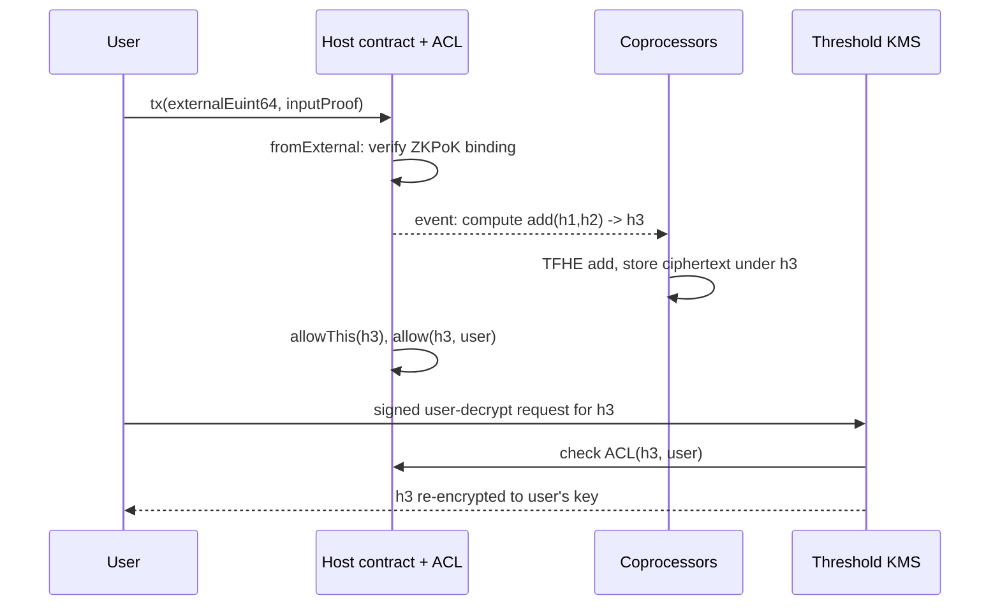

# Architecture of FHE Smart Contract Platforms

FHE operations are far too heavy to run inside every validator's execution loop at normal block speeds. Production designs split the work: the chain orders transactions and records *what* to compute, while specialised services do the encrypted computation and a threshold network controls decryption. This chapter describes that architecture generically, using Zama's published protocol documentation (as read in October 2026) as the main reference. Component names and APIs change between releases, so check the current docs of the platform you audit before relying on any name here.

## Components

| Component | Role | Trust it carries |
|---|---|---|
| Solidity library | Encrypted types (`ebool`, `euint8`…`euint256`, `eaddress`), operators, ACL helpers | Correct compilation of operations into symbolic calls |
| Host contracts | On-chain contracts that store handles, enforce the ACL and emit compute requests | ACL integrity; upgrade keys are critical |
| Coprocessors | Off-chain services that verify encrypted inputs, run FHE operations and commit results | Correctness of results; redundancy or consensus among operators |
| Gateway | Orchestrator: validates inputs, keeps ACL state in sync, bridges ciphertexts, coordinates coprocessors and KMS | Liveness and faithful relaying |
| KMS | Threshold MPC network that generates and rotates FHE keys and performs decryption | Confidentiality of everything, ever |
| Relayer | Lightweight service that forwards user encryption and decryption requests | Availability; should not be trusted for integrity |

Zama's overview describes the KMS as "a threshold MPC network that generates and rotates FHE keys and handles secure, verifiable decryption", and the gateway as the component that "validates encrypted inputs, manages ACLs" and coordinates the others. Other projects (Fhenix, Inco and research systems) use different names and boundaries, but the same questions apply: who computes, who can decrypt, and who decides who can decrypt.

## Handles instead of ciphertexts

A TFHE ciphertext for a 64-bit integer is kilobytes in size, and keys are much larger. Storing these in EVM storage would be unaffordable. So the contract stores a 32-byte **handle**: an identifier derived from the operation and its inputs. When a contract computes `FHE.add(a, b)`, the host contract records the operation and returns a new handle, deterministically derived from it. Coprocessors watch these events, fetch the input ciphertexts, compute, and store the result under the new handle.

Three consequences matter for security:

1. **Handles are bearer-like references.** Knowing a handle is not the same as being allowed to use it, so a separate ACL must say who can compute on or decrypt it.
2. **Execution is symbolic and asynchronous.** The transaction succeeds before the ciphertext exists. Code that assumes the result is "ready" in the same transaction for off-chain use will race.
3. **Results must be verifiable.** If a single coprocessor computes `add` wrongly, the ledger now holds a wrong balance that no one can see. Check whether the design uses several coprocessors with majority agreement, re-execution, or proofs.

## Encrypted inputs

Users encrypt client-side with the network public key and submit a ciphertext plus a **zero-knowledge proof of knowledge (ZKPoK)** of the plaintext. In Zama's current Solidity guide, a function takes an `externalEuint64` and `bytes inputProof`, and calls `FHE.fromExternal(value, inputProof)`, which "ensures that the input is a valid ciphertext with a corresponding ZKPoK". The proof is bound to the user and contract addresses. Older releases used `FHE.asEuint64(value, proof)`, so expect version differences.

The ZKPoK stops a classic attack: without it, an attacker could copy a victim's ciphertext from the mempool or storage, submit it as their own input, and get the contract to decrypt or compare it for them. The proof shows the submitter knows the plaintext and binds the ciphertext to a context.

## Decryption paths

There are two common flows:

- **Public decryption.** A contract marks a handle as publicly decryptable (for example `FHE.makePubliclyDecryptable`). An off-chain client asks the KMS via the relayer, receives the cleartext with a decryption proof made of KMS signatures, and submits it back. The contract checks it with `FHE.checkSignatures(handles, cleartexts, proof)`. The docs warn that the proof is bound to the order of the handles.
- **User decryption (re-encryption).** A user who is on the ACL signs a request (typically EIP-712). The KMS re-encrypts the value under the user's ephemeral public key, so only the user sees the plaintext and nothing goes on chain.

## Where FHE platforms differ from ZK privacy

ZK privacy systems (see **privacy-protocol-security** and **zk-circuit-security**) keep the secret with the user and publish proofs. FHE platforms keep secrets *in shared encrypted state* that anyone can compute on. That enables things ZK alone handles poorly, such as sealed-bid auctions where the contract compares bids from different users. The cost is a permanent dependency on the KMS: in ZK systems no committee can reveal your note, but in FHE systems a threshold of KMS nodes can.

Older research made similar trade-offs. Hawk (2016) kept transactions private with an off-chain manager; FHE platforms replace that manager with a threshold network. Write down which party plays that role in the system under review.

## Worked example

*Execution status: Not executed in this book's CI; verify locally. Commands follow Zama's published quick start as of October 2026; names may change.*

1. Clone Zama's Hardhat template (linked from the Solidity guides quick start) and install dependencies with `npm install`.
2. Open the example confidential counter or ERC-20 contract. List every function that accepts an `externalEuint*` and confirm each calls `FHE.fromExternal` with the proof.
3. Run the bundled tests in mock mode (`npx hardhat test`). Mock mode simulates FHE in plaintext, so it checks logic and ACL calls, not cryptography.
4. Add a test where account B submits account A's `(handle, proof)` pair. Record whether the call reverts. If it does not, find out which binding the proof carries in your version.
5. For each state-changing function, write down which handles it creates and which `allow*` calls follow. This inventory feeds the ACL review in Chapter 3.

## Common pitfalls

- Treating the relayer as trusted. Anything it returns must be checked on chain (signatures, handle order).
- Assuming one coprocessor result is correct without redundancy or verification.
- Reading values in the same transaction that requested their computation or decryption.
- Auditing contracts in mock mode and concluding the cryptography or KMS works.
- Ignoring upgrade keys on ACL, gateway and KMS contracts, which can silently widen who may decrypt.

## Exercises

1. For the platform you use, fill in the components table with the real contract addresses and operators on a testnet.
2. Trace one public decryption end to end from the docs and list every signature that is checked, and by whom.
3. Compare the trust assumptions of a sealed-bid auction built with FHE and one built with commit-reveal. Which leaks more, and to whom?

## Further reading

- Zama protocol overview: <https://docs.zama.org/protocol/protocol/overview.md>
- Zama Solidity guides (inputs, ACL, decryption): <https://docs.zama.org/protocol/solidity-guides>
- Kosba et al., "Hawk: The Blockchain Model of Cryptography and Privacy-Preserving Smart Contracts" (IEEE S&P 2016).
- See **decentralized-security-compute** for coprocessor-style trust models.
