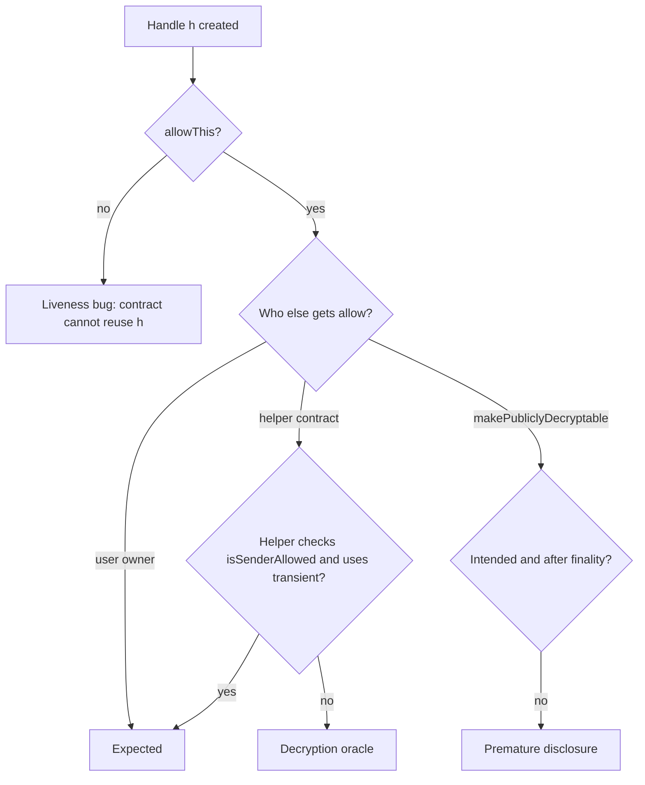

# Ciphertext Handles, ACLs and Reuse Bugs

In an FHE contract platform the access-control list (ACL) replaces the key. Whoever the ACL allows to use a handle can compute with it, pass it on, or ask for it to be decrypted. Most confidentiality bugs found so far in encrypted contracts are ACL bugs, not cryptographic breaks. This chapter covers the ACL model, the bug classes it creates and how to test for them.

## The ACL model

Zama's Solidity guide (October 2026) lists these primitives. Other platforms have equivalents.

| Function | Effect | Lifetime |
|---|---|---|
| `FHE.allow(h, addr)` | `addr` may use or decrypt `h` | Permanent |
| `FHE.allowThis(h)` | Shorthand for `allow(h, address(this))` so the contract can reuse `h` later | Permanent |
| `FHE.allowTransient(h, addr)` | `addr` may use `h` in this transaction only (EIP-1153 transient storage) | Transaction |
| `FHE.makePubliclyDecryptable(h)` | Anyone may obtain the cleartext | Permanent, global |
| `FHE.isAllowed(h, addr)` / `FHE.isSenderAllowed(h)` | Checks | — |

Two properties drive most bugs. **Grants are permanent unless transient**: there is no revoke in the basic model, because the ledger cannot "un-share" a value someone may already have decrypted. **Permissions attach to handles, not values**: every operation creates a new handle with an empty ACL, so the contract must re-grant after each update. Forgetting `allowThis` after an update breaks the contract (a liveness bug). Granting too widely leaks data (a confidentiality bug).

## Bug class 1: handle injection without a sender check

A function that accepts an already-encrypted handle (`euint64`, not `externalEuint64`) from the caller must check that the caller may use it:

```solidity
// Vulnerable: anyone can pass any handle they have seen on chain
function deposit(euint64 amount) external {
    balances[msg.sender] = FHE.add(balances[msg.sender], amount);
    FHE.allowThis(balances[msg.sender]);
    FHE.allow(balances[msg.sender], msg.sender);
}

// Fixed
function deposit(euint64 amount) external {
    require(FHE.isSenderAllowed(amount), "no access");
    ...
}
```

Without the check, an attacker can take a victim's balance handle from an event or storage, "deposit" it into their own record, and then user-decrypt their own new balance. If their previous balance was a known value, subtraction reveals the victim's balance. This is a **decryption oracle built from ACL laundering**.

## Bug class 2: over-broad or permanent grants to helpers

OpenZeppelin's *A Developer's Guide to FHEVM Security* (Sebastian Fabry, December 2025) describes a confidential wrapped-ETH token that gave a fee-calculator contract a permanent `FHE.allow` on transfer amounts, while the calculator did not check its caller. Any contract could call the calculator with a copied handle, get a fee handle derived from it, and receive access. The helper became a decryption oracle. The fix uses `allowTransient` and an `isSenderAllowed` check in the helper.

Audit rule: **every grant to another contract extends the trust boundary to everything that contract can do**. Read the callee's code. If it can make arbitrary calls (`execute(address,bytes)`) or `delegatecall`, it can grant your handles onward. The same guide lists both as ways to turn a privileged contract into a general data oracle.

## Bug class 3: transient permissions that outlive their user

Transient storage lasts for the whole transaction, not for a single call. Under account abstraction, several user operations can share one bundle transaction. OpenZeppelin's guide notes that a transient allowance created for one user's operation can then be used by a later operation in the same bundle, and suggests clearing transient storage (it names `FHE.cleanTransientStorage()`) after each sensitive operation. Similar issues appear with multicall routers and flash-loan callbacks.

## Bug class 4: replayable external inputs

`fromExternal` proofs bind a ciphertext to a user and a contract. If a user encrypts an input for an intermediary (a timelock, a router, a relayer contract), anyone who can make that intermediary call the target may be able to replay the tuple. The guide warns that proof bytes are malleable, so de-duplicating by `keccak256(proof)` is not reliable. Validate in the intermediary, or bind inputs to an explicit nonce in the user's context.

## Bug class 5: stale and legacy state

ACL state lives in a shared contract. When a protocol redeploys, old grants remain valid on old handles. A related pattern from identity systems is described in **decentralized-identity-zk-credentials**: Secure3's Holonym-P1 audit report (2023) found that a "used" marker was not checked against the legacy contract after redeployment, so one person could verify again. For FHE contracts, check that migrations neither drop needed grants nor carry over grants to retired contracts.



## Worked example

*Execution status: Not executed in this book's CI; verify locally in Zama's Hardhat template (mock mode).*

1. In the template, write `Vault.sol` with the vulnerable `deposit(euint64)` above and a `balanceOf(address)` view that returns the handle.
2. Test setup: Alice deposits 1 000 through a proper `externalEuint64` path. Bob deposits 0 the same way, then decrypts his balance (0).
3. Bob reads Alice's balance handle with `balanceOf(alice)` and calls `deposit(aliceHandle)`.
4. Bob user-decrypts his own balance with the template's helper. If it shows 1 000, the oracle works.
5. Add `require(FHE.isSenderAllowed(amount))`, rerun, and confirm the call reverts.
6. Add a script that lists every `FHE.allow` call in the repo (`rg -n 'FHE\.allow\(' contracts/`) and record the target and reason for each in your audit notes.

## Common pitfalls

- Accepting `euint*` parameters from callers without `isSenderAllowed`.
- Using permanent `allow` where `allowTransient` would do.
- Forgetting `allowThis` after every operation that replaces a stored handle.
- Calling `makePubliclyDecryptable` before the result is final (see Chapter 4 on reorgs).
- Granting to contracts that have arbitrary-call, `delegatecall` or upgrade paths.
- De-duplicating encrypted inputs by hashing proof bytes.

## Exercises

1. Implement the Vault example and extend it with a fee helper. Reproduce the helper-oracle pattern, then fix it with transient grants.
2. Write a Slither custom detector or Semgrep rule that flags public functions taking `euint*` parameters without an `isSenderAllowed` call. Test it on three sample contracts.
3. Design a migration plan for a confidential token moving to a new contract, listing every handle that must be re-granted.

## Further reading

- Sebastian Fabry, "A Developer's Guide to FHEVM Security", OpenZeppelin (December 2025): <https://www.openzeppelin.com/news/a-developers-guide-to-fhevm-security>
- Zama ACL guide: <https://docs.zama.org/protocol/solidity-guides/smart-contract/acl>
- Secure3, Holonym-P1 audit report (2023), finding HYM-1 (legacy-state reuse).
- See **ai-static-analysis-rule-writing** for writing custom detectors.
